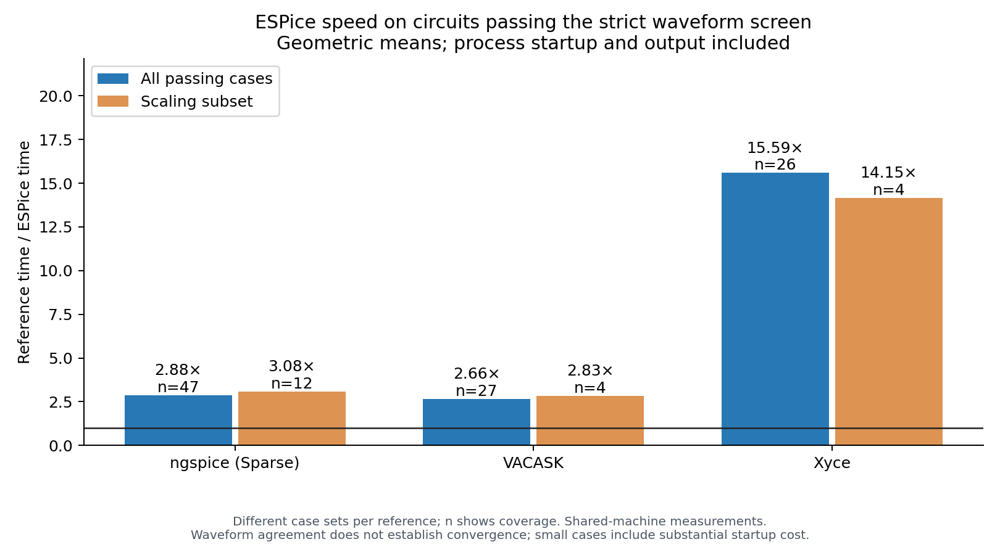
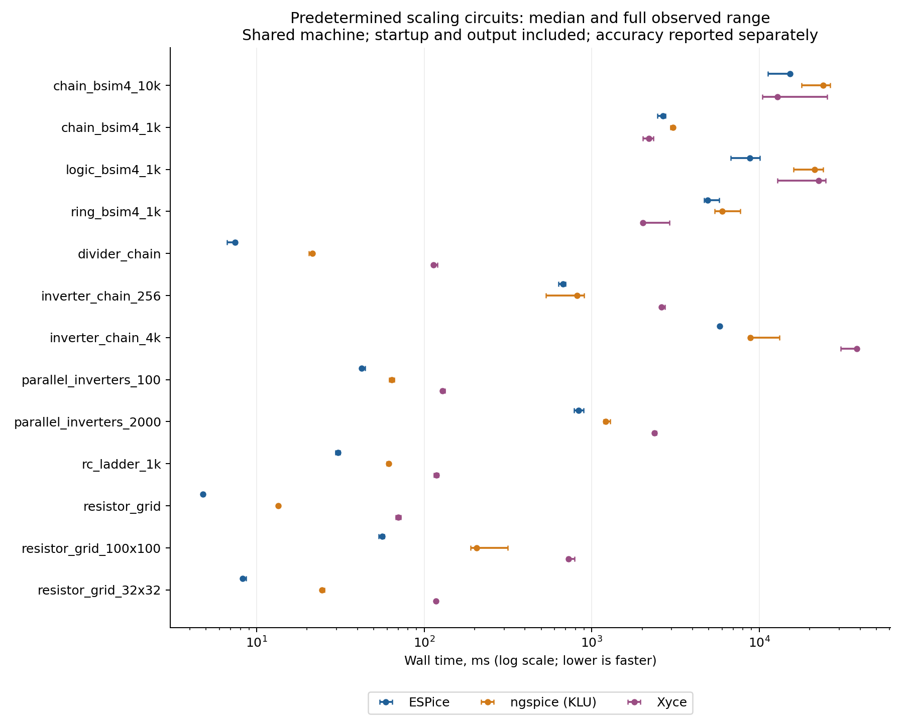

# ESPice comparison — 20 October 2026

This report measures **ESPice 1.2.0 at
`ec53a724d1e67adcb54927e46fbd13af40aed1eb`**, built in ReleaseFast mode.
The CPU binary was frozen before the lane changes in this working session.
GPU lane validation and performance are separate measurements. The
[lane implementation and validation report](lanes.md) records the fixes,
hardware checks, and remaining issue scope.

The main experiment contains 49 circuits selected before timing: 45
repository fixtures plus four generated BSIM4 post-layout circuits.
The exact netlists, including tokenizer metadata, are preserved in
[inputs.tar.gz](inputs.tar.gz), with source hashes in
[fixtures-manifest.json](fixtures-manifest.json).

**Accuracy is not uniformly established.** The 256-stage inverter chain has
a 295 ps default-setting timing error against two refined references.
Some diode differences are caused by different reference models.
Read the [accuracy investigation](accuracy.md) alongside the timings.

The [Xyce performance investigation](xyce-research.md) found an important
input-semantics difference: the two-argument transient card gives Xyce a
much larger default maximum step. Controlled ring and 1k-chain experiments
reverse the timing ranking when that ceiling is matched. Separate ESPice
experiments test the useful optimization: allowing larger steps while
checking accuracy against finer-step references.

## Measured results

ESPice completed all 49 circuits. The table reports geometric means of
reference wall time divided by ESPice wall time; **above 1× means ESPice
was faster**. Each reference has a different set of available comparisons.

| Reference | Both completed | Strict screen passed | Ratio, all completed | Ratio, screen passed |
|---|---:|---:|---:|---:|
| ngspice 45, Sparse | 48/49 | 47/48 | 2.81× | 2.88× |
| VACASK, pinned revision | 40/49 | 27/40 | 2.80× | 2.66× |
| Xyce 7.10.0 | 39/49 | 26/39 | 12.88× | 15.59× |

Passing is pairwise agreement under the declared screen, **not established
accuracy**: default ngspice shares ESPice's inverter-chain timing error.
Among completed comparisons, one VACASK and four Xyce comparisons have
incomplete output coverage; the rest of the nonpassing results contain
numerical differences. The ngspice failure is a current-discontinuity
interpolation effect explained in the accuracy investigation.



The large Xyce ratio is strongly influenced by startup overhead on small
circuits and by which cases pass the screen. It must not be read as a
general large-circuit speedup. The paired KLU scaling results below give
a more useful comparison for larger work.

The full 49-circuit table (`summary.md` beside this file),
[per-circuit graph](comparison.png), and [all timing samples](timings.csv)
retain slow cases, failed runs, and accuracy flags. The original
[runner report](benchmark.md) also retains its historical agreement metric.
The [absolute scaling times](scaling-times.png) show every observed
minimum and maximum alongside the medians.
Machine and executable provenance is in [metadata.json](metadata.json);
the [load timeline](system.jsonl) records conditions during timing.

The median within-case `(maximum − minimum) / median` is 9.9% for ESPice,
6.0% for ngspice, 6.4% for VACASK, and 2.2% for Xyce. Worst-case ranges
reach 144%, 111%, 119%, and 65%, respectively. These observations support
retaining every sample and avoiding claims about small performance
differences or statistical confidence on this shared machine.

## Paired scaling run with ngspice KLU

All three engines completed all 13 cases in this supplemental run. ESPice
was faster than ngspice-KLU on each case, with a **1.89× geometric-mean
ratio**. All 13 pairs pass the waveform screen, with the earlier warning
that matching default results can share numerical error.

Against Xyce, the all-case ratio is **3.72×**, but only four pairs pass
the strict screen. Xyce has a lower measured median on three of the four
BSIM4 post-layout cases:

| Circuit | ESPice, s | ngspice-KLU, s | Xyce, s |
|---|---:|---:|---:|
| BSIM4 chain, 10k | 15.227 | 24.148 | 12.821 |
| BSIM4 chain, 1k | 2.667 | 3.067 | 2.197 |
| BSIM4 logic, 1k | 8.803 | 21.443 | 22.572 |
| BSIM4 ring, 1k | 4.920 | 6.004 | 2.018 |

All four post-layout ESPice/Xyce pairs fail the strict screen on small
output voltages, with maximum differences of approximately 35–140 µV.
These timings therefore do not establish a winner at matched accuracy.
The corrected output-selection adapter makes their waveforms comparable;
it does not make them agree.
They also use different resolved step ceilings. The
[controlled follow-up](xyce-research.md) explains the resulting work-count
difference; it does not replace these historical default-setting samples.



This is a separate one-warm-up, three-repetition experiment; its ESPice
times were measured alongside its references. Do not combine them with
the seven-repetition VACASK/default-Sparse times above.
See the [complete scaling table](scaling-klu/summary.md),
[individual repetitions](scaling-klu/timings.csv),
[accuracy diagnostics](scaling-klu/accuracy.jsonl.gz), and
[provenance](scaling-klu/metadata.json).

## Method

- Intel Core i9-14900HX, 32 GiB RAM, NixOS; default `powersave` governor.
- Within each timing experiment, simulators run serially, pinned to logical CPU 2.
  ESPice uses `--backend=cpu --jobs=1 --full-waveforms`,
  `ESPICE_THREADS=1`, and `ESPICE_LU_PAR=0`. OpenMP and BLAS thread counts
  are also one.
- Main experiment: one warm-up, then seven repetitions. Engine order
  rotates every repetition and the initial order rotates by circuit.
  Reported times are medians of end-to-end wall time, including process
  startup, parsing, simulation, and output. VACASK input translation
  happens outside timing.
- Per-run timeout: 120 seconds. A failed repetition invalidates that
  engine/circuit measurement. Failures and unsupported cases remain in
  coverage counts and do not become speedups.
- ngspice 45 uses its default Sparse solver in the main experiment.
  A separate 13-circuit scaling experiment enables KLU and reruns ESPice
  alongside it and Xyce, with one warm-up and three measured repetitions.
  Its Xyce adapter translates SPICE `.save` selections to native
  `.PRINT ... FORMAT=RAW` output without changing the circuit.
- Xyce is 7.10.0. VACASK is the repository's pinned revision
  `bcd48e2dd25182f5aaa3392c4e27b4e198372744`. Simulator executable hashes and complete
  invocations are retained with the results.

These are **shared-machine measurements**: other development builds,
tests, and desktop activity ran during the experiment. CPU affinity and
rotating order reduce some interference but do not remove shared power,
cache, memory, and scheduling effects. The load timeline and individual
samples are retained; this is not an idle-machine or statistical-confidence
claim.

Most of the 49 cases are small, so process startup strongly influences an
overall geometric mean. The predetermined `stress/` and `postlayout/`
subset is shown separately. Each simulator keeps its own numerical
defaults unless the deck specifies options. Equal input text does not
guarantee equal accepted timesteps or equal numerical accuracy.

## Accuracy screen

The historical comparator is preserved in the raw benchmark report.
The additional diagnostic checks finite, nonempty data, analysis coverage,
and sweep coordinates. It compares complex differences by magnitude and
transients on both native time grids, using linear interpolation with
**no time alignment or phase shifts**.

A signal passes when RMS error is at most 0.1% of the reference peak plus
an absolute floor, and maximum error is at most 1% of peak plus that floor.
Floors are 1 µV for voltages, 1 pA for currents, and `1e-24` for noise
amplitudes. These are declared screening thresholds, not a proof of physical
accuracy. Missing outputs and parser limitations are reported separately.
The diagnostic's regression tests explicitly guard against hiding small
currents, candidate-only spikes, repeated-time discontinuities, missing
outer sweep coordinates, and truncated raw files.

Coverage means all reference plots and external signal columns are checked.
Implementation-internal columns are exempt when absent, and duplicate names
use their final occurrence. RMS weights the union of saved sample locations;
it is not a continuous-time integral. Extra candidate data outside the
reference span is not scored. VACASK's converted noise spectra are checked,
but it does not provide the integrated-noise totals saved by ESPice, so those
totals are not validated by the VACASK comparison.

Independent checks cover a balanced bridge, RC and RLC frequency responses,
RC startup and pulse responses, resistor thermal noise, and the
ngspice-compatible diode equation. Model differences are explained in the
[accuracy investigation](accuracy.md).

## Reproduction

Build the baseline ESPice revision in a separate checkout using its pinned
Nix environment, then build this branch's standalone runner:

```sh
nix develop .#ci -c zig build build-benchmark \
  -Doptimize=ReleaseFast -Dgpu=false -Dcuda-arch=none -Dhip-arch=none
mkdir -p zig-out/comparison-reproduction zig-out/reproduction
tar -xzf docs/performance/bench/2026-10-20/inputs.tar.gz \
  -C zig-out/comparison-reproduction
nix develop .#benchmarking -c env OMP_NUM_THREADS=1 \
  OPENBLAS_NUM_THREADS=1 MKL_NUM_THREADS=1 \
  taskset -c 2 zig-out/bin/bench-runner \
  /tmp/espice-baseline-release/bin/espice zig-out/comparison-reproduction \
  --espice espice=ESPICE_THREADS=1,ESPICE_LU_PAR=0,--jobs=1,--backend=cpu,--full-waveforms \
  --xyce Xyce --iters 7 --timeout 120 --out zig-out/reproduction/benchmark.md
```

The corrected Xyce adapter will improve output coverage relative to the
initial main run. Reproduce the supplemental scaling experiment by selecting
the preserved `stress/` and `postlayout/` inputs and adding
`--ngspice-klu --vacask none --iters 3`.

Recreate the accuracy figure from preserved native samples with:

```sh
nix develop .#benchmarking -c python3 \
  docs/performance/bench/2026-10-20/plot_accuracy.py
```
