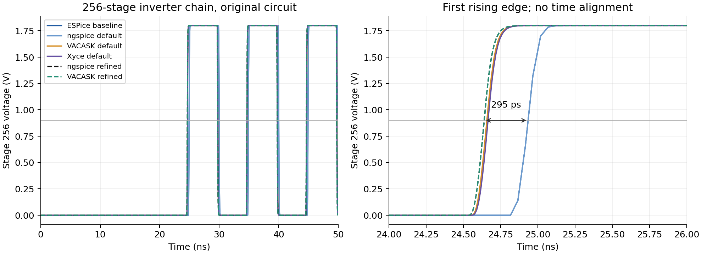

# Accuracy investigation, 20 October 2026

These observations apply to the measured ESPice 1.2.0 binary built from
`ec53a724d1e67adcb54927e46fbd13af40aed1eb`. They distinguish disagreements
between simulators from errors established by an independent equation or
converged reference. They are not a claim that every circuit is accurate.

## Inverter-chain timing: a real concern at the default settings

On `stress/scaling_inverter_chain_256.sp`, the first rising crossing of
`v(s256)` through 0.9 V is:

| Run | Crossing, ns |
|---|---:|
| ESPice, original deck | 24.934747756 |
| ngspice 45, original deck | 24.934747756 |
| VACASK, original translated deck | 24.657878380 |
| Xyce 7.10.0, original deck | 24.665498856 |
| ngspice, refined | 24.639696911 |
| VACASK, refined | 24.639718613 |

ESPice's default result is **295.051 ps late, or 1.197% of the first
propagation delay**, relative to refined ngspice. The refined references
agree at this crossing within **0.0217 ps**. At some intermediate nodes the
default ESPice/reference difference reaches approximately a full 1.8 V
logic swing because the transitions occur at different times.

The refined reference runs already existed in this shared workspace. Their
samples were independently read, their crossing times recomputed, and their
circuits checked against this benchmark's frozen inputs. Only the analysis,
output selection, and numerical controls differ. Refined ngspice uses a 1 ps
maximum step, `reltol=1e-6`, `abstol=1e-15`, `vntol=1e-9`, and
`chgtol=1e-18`. Refined VACASK uses those tolerances with its original 100 ps
maximum step and adapts to a much finer grid. Their complete decks, selected
native samples, and source hashes are preserved here.

The default ESPice and ngspice runs use 1,047 accepted points; the refined
references use 69,916 and 72,459. This is evidence of a numerical accuracy
and runtime tradeoff. The fast default timing is not a measurement at the
refined references' accuracy. No time shifts were applied to this figure.

## Diode high injection: different reference equations

For `dc/device_diode_high_injection.sp`, independent bisection of the
ngspice diode equation plus its 50 Ω series resistor gives a maximum
current error of **2.091 nA** for both ESPice and ngspice across 401 points.
At a 2 V applied voltage, both produce 24.499086358 mA.

VACASK instead produces 25.227826244 mA, a difference of 0.728740 mA.
Its pinned diode model initializes `DIOforwardKneeCurrentGiven` to zero and
never enables it; its high-injection correction is therefore inactive.
Its output closely follows the equation with that correction omitted.
This is a reference-model omission, rather than evidence that ESPice's
ngspice-compatible result is wrong. [Pinned VACASK diode source](https://raw.githubusercontent.com/robtaylor/VACASK/bcd48e2dd25182f5aaa3392c4e27b4e198372744/devices/spice/diode.va)

Xyce 7.10.0 uses the correction factor
`sqrt(IKF / (IKF + Inorm))`, whereas ngspice uses
`1 / (1 + sqrt(Inorm / IKF))`. Its different result is consistent with
that model choice. The largest ESPice/Xyce current difference in the sweep
is 0.232855 mA. [Xyce 7.10.0 diode source](https://raw.githubusercontent.com/Xyce/Xyce/Release-7.10.0/src/DeviceModelPKG/OpenModels/N_DEV_Diode.C)

The original raw results remain unchanged. The independent equation checks
are recorded in [diode-oracles.json](diode-oracles.json).

## MOS1 gate capacitance: a VACASK model omission

On `tran/device_mos1_large_signal.sp`, ESPice and ngspice agree to about
`5e-17 A` on gate current, whose peak is 0.568408 mA. VACASK reports zero
gate current despite the specified `CGSO` and `CGDO` parameters. In the
pinned model, absent `TOX` makes the oxide capacitance zero. That sets
`meyer_scale=0`, which also zeroes the overlap-capacitance current terms.
The translated deck preserves the original overlap parameters. This
explains the discrepancy without attributing it to ESPice.
[Pinned VACASK MOS1 source](https://raw.githubusercontent.com/robtaylor/VACASK/bcd48e2dd25182f5aaa3392c4e27b4e198372744/devices/spice/mos1.va)

## A strict-screen failure at a current discontinuity

The only ESPice/ngspice strict-screen failure is
`tran/bench_ngspice_mosamp.sp`. At the pulse fall-end, 5.003 µs, both save
the same current jump. Their first samples after that corner occur about
1.045 fs and 2.543 fs later. Linear interpolation across the longer
reference interval produces a 5.51 mA apparent `i(vin)` difference at
ESPice's earlier sample. The values on either side of the jump agree
closely; this particular maximum is dominated by interpolation across a
discontinuity, rather than a sustained waveform offset.

The screen remains failed, and these samples are preserved in
[mosamp-edge.json](mosamp-edge.json). No times were shifted or samples
discarded to make it pass. All voltage signals pass the screen; the largest
voltage difference is approximately 0.255 mV. This case illustrates why
screen failures require inspection rather than automatic blame.

## Smaller differences and comparison limits

The three 1k BSIM4 post-layout cases differ from VACASK by approximately
0.06–0.17 mV on some selected outputs. These signals are small enough that
the differences fail the stricter screen despite passing the historical
comparator. They must not be silently counted as accurate speedups.

For the 1k extracted chain, a separate refinement run set a 0.2 ps maximum
step, `reltol=1e-5`, `abstol=1e-14`, and `vntol=1e-8`. ESPice and ngspice
then agree within 0.4 pV on the selected signals. The largest selected
ESPice/VACASK difference falls from approximately 169 µV to 18.2 µV.
That residual still fails the maximum-error screen for two approximately
1.17 mV outputs. Refinement strongly reduces the discrepancy, but full
convergence has not been established. The [refined deck](chain_bsim4_1k_tight.sp)
and [diagnostics](chain-refinement-accuracy.jsonl) preserve the experiment.
Its single measured repetition is an accuracy investigation and is excluded
from the headline performance statistics.

The NAND operating-point case differs from Xyce by 3.85 pA in supply
current. Its large relative percentage reflects a tiny leakage current;
the absolute scale matters when interpreting it.

Other default-setting disagreements remain in the 4k inverter chain,
parallel inverters, RC ladders, and rectifier. For example, the 4k chain
differs from Xyce by up to 1.79 V; the 2,000 parallel-inverter case differs
from VACASK by 35.2 mA in supply current; the rectifier differs by about
147 mA at startup. These are retained in the full
[per-signal diagnostics](accuracy.jsonl.gz). They have not all been isolated
to an ESPice error, a reference error, or interpolation.

Independent RC checks give more useful context than pairwise agreement:
ESPice's sinusoidal-startup maximum voltage error is 33.0 nV. For the
finite-rise pulse response, maximum errors are 1.111 mV for ESPice and
ngspice, 14.692 mV for VACASK, and 1.015 mV for Xyce, evaluated at each
simulator's native samples. The [analytic results](analytic.json) retain
all individual checks.

Several Xyce device plots expose extra internal nodes, such as
`Q1_BASEPRIME`, that ESPice does not save. The conservative diagnostic
marks these as incomplete coverage. VACASK's two-dimensional BJT sweep
also exposes an outer coordinate absent from ESPice's raw metadata.
These are comparison limitations, not established voltage/current errors.

VACASK writes noise power and squared transfer gain. The diagnostic
converts these to `sqrt(onoise)` and `sqrt(onoise/gain)` before comparing
SPICE noise amplitudes, and records the conversion. Without it, different
units would be compared. [Pinned VACASK noise implementation](https://raw.githubusercontent.com/robtaylor/VACASK/bcd48e2dd25182f5aaa3392c4e27b4e198372744/lib/corenoise.cpp)

The bridge and linear RC/RLC frequency responses agree with independent
circuit equations to floating-point precision. Those simple successes do
not establish accuracy on the nonlinear transient cases above.
