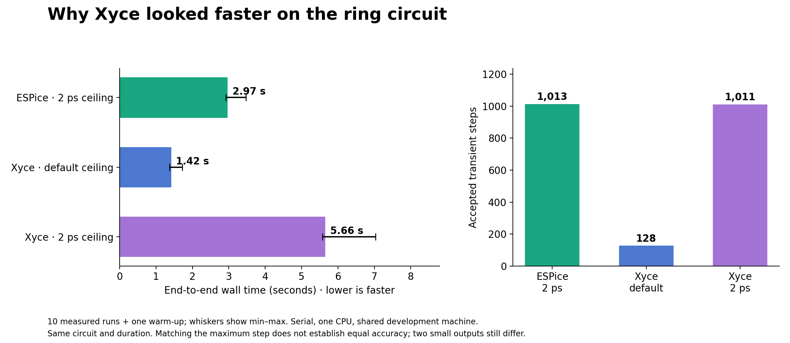

# Why Xyce looked faster, and what ESPice can use

The controlled ring experiment identifies a major cause of Xyce's apparent
advantage: **the same two-argument `.tran` card imposes different maximum
steps**. Xyce completed far fewer transient steps. Giving it ESPice's
2 ps ceiling reversed the measured ranking.

The more useful optimization question is whether ESPice can safely use
larger steps too. ESPice already supports that through the fourth `.tran`
argument or `DELMAX`; no simulator implementation change is needed to test
it. The separate ESPice ceiling experiment below measures that opportunity.

## What the defaults do

For `.tran 2p 2000p`, starting at time zero:

| Engine | Meaning of the first argument | Resolved default ceiling |
|---|---|---:|
| ESPice / ngspice | Used in the SPICE default maximum-step rule | `min(2 ps, 2000 ps / 50)` = **2 ps** |
| Xyce 7.10 | Initial-step input | `2000 ps / 10` = **200 ps** |

The Xyce ceiling is a fixed fraction of the requested duration, not a
circuit-specific optimum. Its adaptive error controller chooses the actual
steps, with device bounds and breakpoint landing also constraining them.
The largest saved interval in our default Xyce ring run was **50.53 ps**.
[Xyce `.TRAN` documentation](https://github.com/Xyce/Xyce/blob/Release-7.10.0/doc/Reference_Guide/TRAN_Command.tex#L35-L49),
[release implementation](https://github.com/Xyce/Xyce/blob/Release-7.10.0/src/TimeIntegrationPKG/N_TIA_StepErrorControl.C#L899-L927).

Xyce normally estimates local integration error from a weighted RMS of
predictor/corrector differences. Its default global-amplitude weighting
differs from ESPice's ngspice-style bound over individual device charge
states. Both already adapt steps, reject failed attempts and reduce steps
at breakpoints. Equal numeric tolerance values do not equate these
policies. [Xyce error weights](https://github.com/Xyce/Xyce/blob/Release-7.10.0/src/TimeIntegrationPKG/N_TIA_DataStore.C#L1344-L1472),
[error estimator](https://github.com/Xyce/Xyce/blob/Release-7.10.0/src/TimeIntegrationPKG/N_TIA_OneStep.h#L93).

The exact source audit also records discrepancies between the documentation
and implementation for nonzero output start times and the optional
between-breakpoint step count. Neither changes this zero-start experiment.
See the [time-integration audit](xyce-research/time-integration-audit.md).

## Controlled ring result

One warm-up and ten measured runs per variant, serial execution on logical
CPU 2, one simulator worker, rotating order. Same frozen ReleaseFast ESPice
binary as the original comparison. This is a shared development machine;
minima and maxima are retained and are not confidence intervals.

| Variant | Median wall time | Observed range | Accepted transient steps |
|---|---:|---:|---:|
| ESPice, explicit 2 ps ceiling | 2.972 s | 2.922–3.473 s | 1,013 |
| Xyce, default ceiling | 1.418 s | 1.368–1.720 s | 128 |
| Xyce, explicit 2 ps ceiling | 5.655 s | 5.578–7.034 s | 1,011 |
| Xyce, 2 ps, linear cache disabled | 6.334 s | 6.279–7.586 s | 1,011 |



The Xyce transient Jacobian/linear-solve count increased from **308 to
1,620** when its ceiling changed from default to 2 ps. A separate ESPice
diagnostic counted **2,034** transient Newton iterations/factor calls.
These engines do not perform identical work even at the same ceiling.

Matching the ceiling reduced differences, but **two small ring outputs
still fail the pairwise accuracy screen**, with maximum differences of
approximately 23 and 12 µV. This experiment establishes a timestep-policy
effect, not a winner at matched accuracy.

The 1k chain independently showed the same reversal in five measured
repetitions: ESPice **2.170 s**, default Xyce **1.920 s**, and Xyce with the
same 2 ps ceiling **4.726 s**. The additional 10k-chain run was interrupted
when the investigation switched to larger ceilings in ESPice; its partial
samples are retained but are not used as a completed experiment.

## The opportunity in ESPice

The existing control is:

```spice
* Keep the initial-step input; allow the controller to grow beyond it.
.tran 2p 2000p 0 200p
```

Increasing only this ceiling produced a large speedup on the ring, but also
changed the waveform materially. The 200 ps trial differed from the 2 ps
trial by approximately **79 mV** on one output. That is an accuracy tradeoff,
not an established replacement for the current default.

The ongoing accuracy experiment compares ceilings of 2, 5, 10, 50 and
200 ps against ESPice and ngspice runs at 0.2 and 0.1 ps with tighter
tolerances. A wide ceiling plus tighter error control is also being tested.
Adoption requires preserved waveform and measurement accuracy, including
small signals and accumulated timing error; the existing 256-stage chain
already demonstrates why default-to-default agreement is insufficient.

## Other concrete optimization candidates

1. **Aggregate linear residual and charge loading.** Xyce's
   `SEPARATELOAD` cache avoids repeated per-device linear loading by using
   cached matrices. Disabling it made every paired ring run slower:
   median paired speed ratio **1.129×** with the cache enabled. All work
   counts were unchanged, and the largest cache-on/off waveform difference
   was **2.09 pV**. This is evidence for the feature in Xyce, not a promised
   ESPice speedup. ESPice already caches constant Jacobians; the additional
   opportunity concerns linear residual/charge work.
   [Xyce loader](https://github.com/Xyce/Xyce/blob/Release-7.10.0/src/LoaderServicesPKG/N_LOA_CktLoader.C#L700-L786).
2. **Reduce BSIM4 derivative work.** ESPice's instrumented ring run spent
   about 52% of transient active time in device evaluation and 21% in
   factorization. Its existing derivative-basis optimization currently
   excludes BSIM4. The inspected model configuration has a plausible
   11-to-4 derivative-lane reduction after topology collapse. This is a
   guarded experiment to profile and validate, not a measured gain.
   See the [device audit](xyce-research/device-source-audit.md).
3. **Retain BTF blocks during factorization if matrix profiles justify it.**
   ESPice already has BTF/AMD ordering, symbolic reuse and guarded pivot
   replay. KLU retains diagonal block boundaries and separate off-block
   storage; ESPice currently flattens the ordering into one LU. Its value
   depends on the actual matrix's reducibility and fill.
   See the [solver audit](xyce-research/solver-source-audit.md).

The measured Xyce build is serial. MPI parallelism did not cause these
results. Generic recommendations to add analytic derivatives, model setup
caching, fixed stamp addresses or factor reuse would duplicate capabilities
ESPice already has.

## Evidence and limitations

- [Controlled timing table](xyce-research/timings.csv) and
  [summary](xyce-research/summary.json).
- [Every ring output's stop-time/maximum-step validation and direct
  cache comparison](xyce-research/ring-controlled-validation.json).
- Exact Xyce release source:
  `a592a42ae7472151d1c8e3bca0ca62d27476f2f3`.
- The source audits describe mechanisms separately from proven causes.
  Initial exploratory timings, including a cache-off run overlapping a
  `perf` diagnostic on the same CPU, are excluded from the controlled
  timing table.
- The internal ESPice phase profile is instrumented and belongs to its own
  diagnostic run. It is not substituted for an uninstrumented timing
  sample. The stripped release executable prevented useful symbolic
  attribution of the separate `perf` samples.
